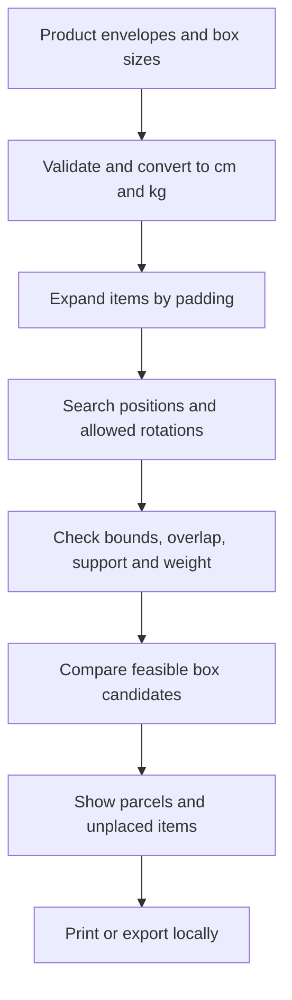

# Cartonroom

A practical packing planner for small shops. Enter an order and the boxes you have, then see a geometrically feasible packing plan before you start packing.

Live application: https://cartonroom.vercel.app/

## Why it exists

Packing an order by eye takes trial and error. A larger carton can use more material and add to dimensional-weight charges. Cartonroom helps a seller compare their actual box sizes and see where each item envelope goes. It is designed for a single packing station and keeps workspace data in the browser.

Carton-sizing tools already exist, including [Packwire](https://packwire.com/box-size-optimizer) and [Fits In The Box](https://fitsinthebox.com/faq/). Cartonroom's focus is an accessible, no-account workflow with user-defined boxes, a visible layout, and portable local data. We have not yet measured time or cost savings with real sellers.

## Workflow

1. Add products with packaged dimensions, quantity, content weight and optional upright orientation.
2. Add available carton inner dimensions and maximum content weight.
3. Set protective padding per item side and select measurement units.
4. Generate a plan. Review the arrangement and the item placement list, including any unplaced items.
5. Print the plan or export a JSON workspace for backup and reuse.

The example workspace is explicitly marked and optional. Cartonroom does not transmit product data to an external API. Browser storage is local to the device and browser profile. Export a backup if it matters.

## How it works



The engine uses a bounded, deterministic greedy heuristic and several item orderings. It chooses the smallest-volume candidate box that holds all remaining items when one is found. Otherwise it favors the candidate that places the most items and breaks ties by box volume. The 3D diagram and coordinates come from the same placement data.

### Limits that matter

- This is a heuristic, not a proof of the globally optimal packing. A workable arrangement might exist even if this search does not find it.
- All shapes are rectangular padded envelopes. The support check applies to those envelopes, not the real products inside padding. It does not model fragility, compression, box tare, shifting, labels or load distribution.
- The weight limit is for contents only. Box quantities are assumed unlimited. Enter real usable internal dimensions and appropriate protection, then verify the physical pack before shipping.
- The tool does not connect to couriers or calculate carrier rates, emissions or guaranteed savings.
- Workspace data lives in browser storage. It is not a shared multi-user service and can be lost when browser data is cleared. Export backups.
- Limits: 30 total items, 12 box sizes, 1,000 cm per dimension and 25 cm padding per side.

## Run locally

Node.js 20+ is needed for the test runner. The website itself has no package dependencies or build step. Serve the directory with a local HTTP server, for example:

```sh
python3 -m http.server 8000
```

Open `http://localhost:8000`. A web server is needed for ES modules. Run the tests with:

```sh
npm test
```

The tests cover exact fits, rotation, padding, weight, split orders, no-fit cases, support, non-overlap, invalid input and deterministic geometry scenarios. They do not replace real user testing or a carrier's packing requirements.

## Project structure

| Path | Purpose |
| --- | --- |
| `index.html`, `style.css`, `app.js` | Accessible user interface and local workspace |
| `packing.js` | Pure geometry and box selection engine |
| `tests/packing.test.js` | Node test suite for the packing engine |
| `docs/PLAN.md` | Research, scope, acceptance criteria and technical decisions |
| `vercel.json` | Static security response headers |

Deploy these files as a static website on Vercel or another static host. Preserve the response security headers if deploying elsewhere. No environment variables, secrets, database or API credentials are needed.

## Research

The packing approach was informed by research into variable-sized 3D packing for e-commerce: [Optimizing e-commerce warehousing through open dimension management](https://pmc.ncbi.nlm.nih.gov/articles/PMC10588690/). Existing food-rescue allocation and caregiver-transition concepts were considered before selecting the current product; see `docs/PLAN.md` for reasoning. User outcomes and cost savings have not been validated.

## License

MIT. See [LICENSE](LICENSE).
