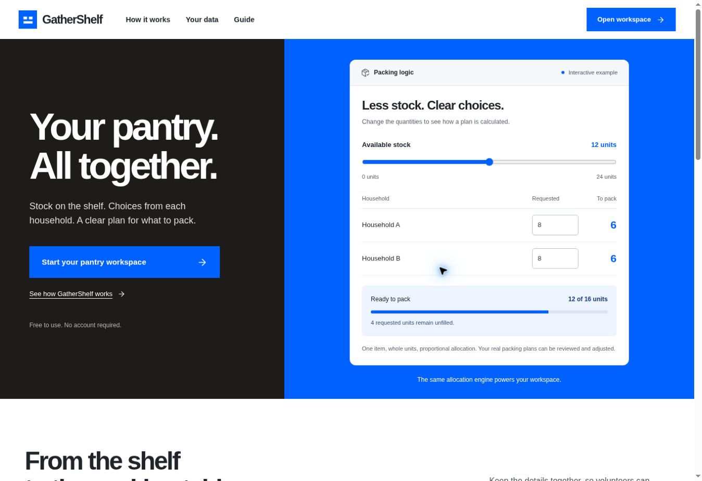
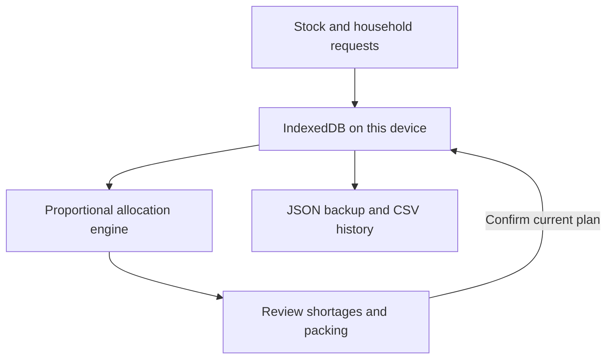

# GatherShelf

A practical workspace for community food pantries to record stock, capture household choices, and review packing plans when supplies are limited.

[Open GatherShelf](https://gathershelf.vercel.app/) · [Workspace guide](https://gathershelf.vercel.app/guide)



## The problem

Pantry volunteers often work from a changing list of donations and have to match that stock to what people actually ask for. A client-choice approach can allow people to select items from an inventory list while volunteers prepare the bags. GatherShelf supports that workflow on a single device without requiring a sign-in.

## What you can do

- Add and edit stock in whole units, optionally recording a best-before date.
- Combine stock search, category and availability filters; sort by name, quantity or date and export stock as CSV.
- Create requests with a household reference and the exact quantities requested.
- Review a packing plan, including shortages, and adjust quantities without changing household requests before recording anything.
- Record a distribution atomically: stock decreases and unfilled requests remain open.
- Inspect history, print the plan, export a CSV or back up and restore the workspace as JSON.

When stock is limited, the planner uses largest-remainder proportional allocation separately for each item. It never adds an item that was not requested. This is a reproducible starting point, not a claim that the result is universally fair. Ties are resolved by stable request IDs. Staff remain responsible for the final decision and should check labels, allergens, dates, and local policy. It is not nutrition, food safety, or eligibility advice.

## Architecture



There is no server-side database, authentication, analytics, external API, or cross-device sync. All workspace records reside in the browser's IndexedDB. A revision check and transactional write prevent stale plans or concurrent tabs from silently overwriting newer state. Backups contain all data in plaintext, so they should be stored securely. Clearing browser storage removes the workspace; export regular backups. This is designed for a single device, not simultaneous multi-user operations.

## Getting started

Node.js 20 or newer is needed only for the tests. Run a static server from the project directory:

```sh
python3 -m http.server 8000
```

Open `http://localhost:8000`. HTTPS is needed for `crypto.randomUUID()` on non-localhost deployments. There are no environment variables, account credentials, or dependencies. Browser storage must be enabled.

## Tests

```sh
npm test
```

The 14 automated tests cover allocation, conservation of stock, stale and modified plans, incomplete demand, combined filtering and sorting, validation, backup round trips, and CSV formula injection. Automated tests do not establish pantry outcomes or replace usability, accessibility, and security testing with real users.

## Research and limitations

See [product and research notes](docs/PRODUCT.md), [verification notes](docs/TESTING.md), [interface reference map](docs/DESIGN.md), and the [draft project story](docs/DEVPOST-DRAFT.md). The plan is an item-quantity allocator, not a dietary needs engine. It does not validate food safety, expiry, allergies, cultural preferences, eligibility, or stock accuracy. It depends on volunteers accurately entering stock and requested quantities. No field study has yet established user benefit.

## License

MIT. See [LICENSE](LICENSE). Lucide icon notices are in [THIRD-PARTY-NOTICES.md](THIRD-PARTY-NOTICES.md).
